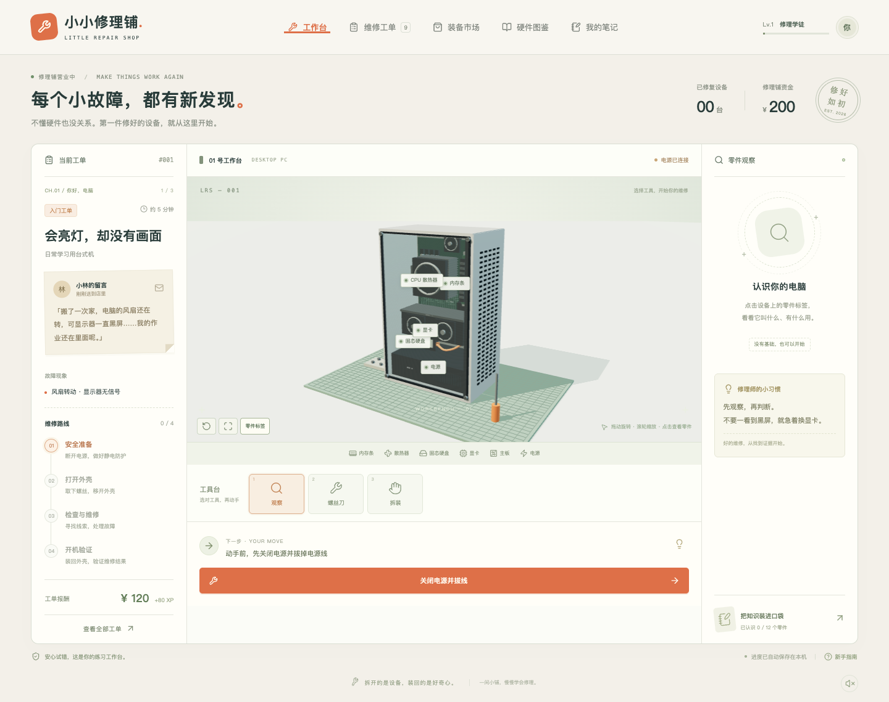

# 小小修理铺 · Cyber Hardware Doctor

给硬件新手的网页维修游戏原型：读懂工单，观察零件，选对工具，处理故障，再验证结果。通过新零件教学、工具原理提示和章节成长，把维修知识放进游戏操作里。

当前版本有 **3 个可玩章节、9 个关卡、12 个零件图鉴、8 种操作工具和 6 种可购买装备/套件**，另有覆盖 12 类设备的长期章节地图。页面里的“已制作”和“筹备中”明确区分实现状态。



## 本地试玩

需要 Node.js 20.19+ 或 22.12+。

```sh
npm ci
npm run dev
```

打开 http://127.0.0.1:5188 。无需 API key、账号或后端，进度保存在当前浏览器的 localStorage。字体服务不可用时自动使用本机字体。

```sh
npm test              # 维修流程、操作约束、章节解锁与采购预算
npm run build        # 构建静态网站到 dist/
npm run preview      # 预览构建结果
npm run test:browser # 开发服务器启动后，实际点击玩通九关
```

浏览器测试优先使用 macOS 本机 Chrome；其他环境先运行 `npx playwright install chromium`。截图输出到忽略提交的 `artifacts/`。

## 怎么玩

1. 阅读客户留言与故障现象，先关闭并断开电源，做好静电防护。
2. 从工具台选螺丝刀，卸下四颗教学用固定螺丝，再移开外壳。
3. 拖动旋转设备、滚轮缩放；点击 3D 零件标签或底部的零件按钮，使用观察工具检查。第一次发现零件时会出现原理与注意事项。
4. 按线索选择零件与工具，完成维修步骤。工具首次用于当前场景时会弹出方法和用途教学。
5. 装回外壳、固定螺丝、接回电源并验证；回答一道知识题后交付。
6. 领取维修费和经验，解锁下一关；去装备市场购买后续工具。装备与套件永久保留，重玩不重复发放奖励。

数字键 `1–8` 切换工具，`Esc` 关闭窗口；灯泡按钮显示当前步骤的提示。3D 不可用时，可以用零件按钮继续全部维修流程。

## 已制作的章节

| 章节           | 关卡                           | 新知识与工具                                               |
| -------------- | ------------------------------ | ---------------------------------------------------------- |
| 你好，电脑     | 黑屏 / 高负载关机 / 无启动设备 | 内存卡扣、散热鳍片、SATA 数据与供电；气吹和接线套件        |
| 风又吹起来了   | 风小 / 轴承异响 / 完全不转     | 气吹的场景迁移、可维护轴承、断电通断测试；润滑工具和万用表 |
| 找回敲击的声音 | 单键卡顿 / 单键漏字 / 全键失联 | 拔键与拔轴的区别、热插拔、信号路径、FFC 锁扣               |

三个设备都有独立的程序生成 3D 模型。维修步骤通过统一状态机约束，买不到的工具不能使用，答错可复习重试。所有测量结果和故障为预设教学模拟。

## 长期章节地图

按操作复杂度建议排列：**低压灯具 → 鼠标 → USB 风扇 → 键盘 → 游戏手柄 → 电脑 → 手机 → 电视机 → 冰箱 → 微波炉 → 车类 → 飞机类**。这是课程规划顺序；当前试玩路线从已制作的电脑章开始，接着风扇和键盘。

地图中每类设备都有三档案例设计、将引入的装备和学习边界；尚未制作的章节可以查看设计，不能假装进入可玩关卡。完整规划见 [游戏设计](docs/GAME_DESIGN.md)。

## 技术结构

- React + Vite：界面、弹窗、章节与市场；React reducer 管理本机档案。
- Three.js：模型、材质、光照、阴影、射线点选；复用官方 `OrbitControls`。
- `src/game.js`：零件、工单、采购目录、维修目标与纯状态转换。
- `src/tutorials.js`：按工具及设备场景组织的教学内容。
- `src/roadmap.js`：长期章节地图与制作状态。
- `src/Workbench.jsx`：三个程序生成设备与工作台，没有远程模型下载。
- `src/main.jsx`：进度存储、教学、装备购买与页面交互。

这是可操作的原型，零件拆装用点选和步骤按钮表达，尚未实现自由抓取、真实刚体物理、电路求解或多故障随机生成。真实设备需按具体型号手册维修；高压、市电、制冷、车辆安全系统和航空维修只规划为专业虚拟模拟。

调研到的 Steam 游戏、开源框架、装机项目与硬件资料见 [调研记录](docs/RESEARCH.md)，依赖许可见 [第三方说明](THIRD_PARTY.md)。
