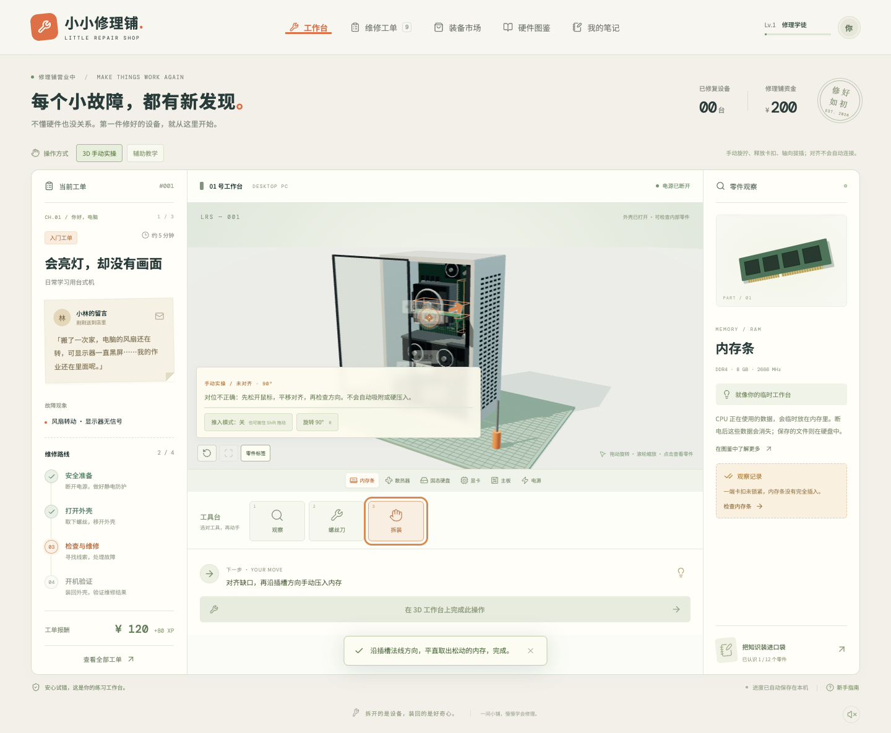

# 小小修理铺 · Cyber Hardware Doctor

给硬件新手的网页维修游戏原型：读懂工单，观察零件，选对工具，处理故障，再验证结果。通过新零件教学、工具原理提示和章节成长，把维修知识放进游戏操作里。

当前版本有 **3 个可玩章节、9 个关卡、12 个零件图鉴、8 种操作工具和 6 种可购买装备/套件**，另有覆盖 12 类设备的长期章节地图。页面里的“已制作”和“筹备中”明确区分实现状态。

**操作完成度：前六关默认采用 3D 手动实操，其余三关目前为辅助教学演示。** 电脑三关练习手动机箱拆装、内存拔插、气吹清灰和 SATA 接线；第四关练习 USB 风扇护网拆装和分区清洁；第五关练习可维护轴承的阻力检查、背面胶塞拆装、少量点油与复查；第六关用可拖动表笔测线，完成仪表自检、断路定位、新线复测与接回。机械步骤不能点击任务按钮跳过。


## 本地试玩

需要 Node.js 20.19+ 或 22.12+。

```sh
npm ci
npm run dev
```

打开 http://127.0.0.1:5188 。无需 API key、账号或后端，进度保存在当前浏览器的 localStorage。字体服务不可用时自动使用本机字体。

```sh
npm test              # 维修流程、操作约束、章节解锁与采购预算
npm run build        # 构建静态网站到 dist/
npm run preview      # 预览构建结果
npm run test:browser # 开发服务器启动后，实际点击玩通九关
npm run test:direct  # 用真实鼠标玩通前六关的旋拧、拔插、清灰、轴承维护与表笔测线
node tests/direct-browser.mjs --storage # 单独验证第三关（使用已完成前两关的测试存档）
node tests/direct-browser.mjs --fan # 单独验证第四关（使用已完成电脑章的测试存档）
node tests/direct-browser.mjs --bearing # 单独验证第五关（使用已完成前四关的测试存档）
node tests/direct-browser.mjs --cable # 单独验证第六关（使用已完成前五关的测试存档）
```

浏览器测试优先使用 macOS 本机 Chrome；其他环境先运行 `npx playwright install chromium`。截图输出到忽略提交的 `artifacts/`。

## 怎么玩

1. 阅读客户留言与故障现象，先关闭并断开电源，做好静电防护。
2. 从工具台选螺丝刀，卸下四颗教学用固定螺丝，再移开外壳。
3. 拖动旋转设备、滚轮缩放；点击 3D 零件标签或底部的零件按钮，使用观察工具检查。第一次发现零件时会出现原理与注意事项。
4. 按线索选择零件与工具，完成维修步骤。工具首次用于当前场景时会弹出方法和用途教学。
5. 装回外壳、固定螺丝、接回电源并验证；回答一道知识题后交付。
6. 领取维修费和经验，解锁下一关；去装备市场购买后续工具。装备与套件永久保留，重玩不重复发放奖励。

数字键 `1–8` 切换工具，`Esc` 关闭窗口；灯泡按钮显示当前步骤的提示。3D 不可用时，可以用零件按钮继续全部维修流程。

## 首关的 3D 手动操作



- 选中螺丝刀，对准螺丝圆环，按住并逆时针旋转两圈才可取下；装回则顺时针旋紧。转错方向不推进。
- 用拆装工具握住侧板标记，沿水平方向滑开。拆完螺丝不会自动打开侧板。
- 观察内存后，分别沿箭头拨开上下两个卡扣。只释放一端不能拔出。
- 握住内存，沿插槽法线箭头平直拉出。另一条内存和插槽卡扣保持在主板上。
- 重新安装内存时，默认进入“沿槽推入”：保持拔出时的横向对位，握住标记沿箭头拖动即可压入，无需按 `Shift`。**松开在正确位置不会吸附，也不会自动连接**。
- 需要调整位置时切换“平移对位”，将握持点移向绿色十字。方向键或屏幕箭头可小步微调，`R` 或旋转按钮改变方向；“维修近景”可放大操作区域。位置和缺口方向分别提示，对准后标记变绿。
- 对准后切回“沿槽推入”再拖动，或按住 `Shift` 沿箭头拖动，才会沿插槽轴线压入。横向位置或朝向错误时会阻挡，不能硬压穿过。
- 压到安装深度后，还要逐个向内锁紧两个卡扣。侧板也要先平移对位，再主动推入、重新旋紧螺丝。

这些是针对该教学机型的机械约束与连续姿态操作，不是完整的刚体或材料物理求解。已完成的步骤自动存档，旋到一半的螺丝、尚未完成的拖动等瞬时姿态不会跨刷新保存。需要无障碍操作或只看教学流程时，可明确切换“辅助教学”。

## 第二关的手动清灰

- 沿用首关的手动螺丝与侧板拆装；选观察工具检查散热器，确认积灰线索。
- 先到装备市场购买气吹。选拆装工具，在散热风扇的叶片标记上按住约一秒再松开。模型中的左手会保持叶片固定，右手可切换气吹。
- 选气吹，瞄准六处橙色积灰点，逐处按住约半秒再松开。每次短促气流只清理瞄准的一处，模型中的积灰随之消失；过快点击、长时间连吹或滑离目标不会清理。
- 全部清完后，仍要亲手装回侧板、旋紧四颗螺丝，再通电验证与交付。机械步骤和清灰不能用下方任务按钮完成。
- 已完成的维修步骤会存档；尚未清完的局部积灰进度是瞬时姿态，刷新后从该清灰步骤重新开始。

## 第三关的手动接线

- 工单“我的系统，去哪儿了？”练习 SATA 固态硬盘的连接故障。先购买接线与替换线套件，再亲手卸螺丝、移开侧板并观察硬盘；检查后自动进入硬盘近景，也可随时点“硬盘近景”。
- 区分较宽的 15 针供电接口与较窄的 7 针数据接口。用拆装工具沿箭头轻推供电接头，确认供电已接好；反向拉动不会通过检查。
- 本关的数据线带金属锁扣。选接线工具，按住金属片标记约半秒，再保持按住沿箭头平直拔出；直接拉接头或只点一下锁扣都不能拔出。并非所有 SATA 数据线都有锁扣。
- 检查插头与接口的 L 形防呆缺口。默认保持原来的对位；需要调整时用“平移对位”和方向键微调，`R` 旋转方向。错位或插反会挡住，松手对齐不会自动连接。
- 这是将松动的数据线重新插稳，拔下后仍插回同一个硬盘接口。画面分别标出固定接口与可移动插头，虚线连接两者；沿轴线拔出时横向对位会保持，可直接推回，无需刻意挪偏再对准。
- 切回“沿槽推入”，握住接头沿箭头推到底；锁扣回弹后，还要不按锁扣轻拉接头，确认固定，才算完成接线。随后手动装回侧板、旋紧螺丝、验证并交付。
- 存档仍保留“供电已检查 / 接线已完成”两个维修步骤；拔到一半、对位与锁扣等内部姿态不跨刷新保存，刷新后重新进行尚未完成的步骤。

## 第四关的风扇清洁

- “风变小了”是 USB 风扇章的第一张工单，沿用已购买的气吹。教学机型的前护网由四颗螺丝固定，先断开 USB，逐颗手动旋松螺丝。
- 选择拆装工具，握住护网标记，沿箭头向外拉脱定位柱；松开后再重新握住标记，向左移到风扇旁边。只拆螺丝或只拉离定位柱都不会自动移开护网。
- 观察“扇叶与护网”，长按叶片标记约一秒固定叶片，再选气吹。护网四处、叶片五处积灰分别瞄准、短按约半秒并松开；界面分别记录两部分的清洁进度。长吹、快速点按或滑离目标不会清理。
- 清理完成后，护网仍留在旁边。平移对齐螺孔，必要时用方向键微调；切换“沿槽推入”，主动沿定位柱推回，再逐颗旋紧螺丝、通电验证并交付。对位不会自动装上，错位会阻挡推入。
- 已完成的拆装、固定叶片与完成清洁步骤会存档。尚未完成的护网位移、螺丝旋拧和九处局部积灰进度不跨刷新保存；刷新后会还原到当前步骤的起点。

## 第五关的轴承维护

- “吱呀作响的小风扇”沿用第四关的手动护网拆装，先去市场购买润滑套装。观察电机轴承后，选拆装工具，握住叶片标记绕转轴轻拨一小段并松手；叶片会很快停下，形成转动阻力异常的检查证据。只点一下不能完成检查。
- 视角转到轴承背面。此教学机型具有可访问的检修窗口和注油胶塞：先沿轴线拔出胶塞，松手后再握住标记移到一旁，露出注油孔。界面可随时切换“轴承背面 / 风扇正面”。
- 选润滑工具，对准注油孔短按约四分之一秒并松开，少量点涂一次。过快点按、长时间挤压或滑离孔位都不计入；游戏的按压时长不是真实设备的用油计量方法。适用润滑油与用量以具体型号说明为准，密封轴承不能直接套用。
- 平移胶塞对孔，再切换“沿槽推入”，沿箭头主动压回密封；错位会阻挡，松手对齐不会自动连接。密封后自动回到正面，还必须再次轻拨叶片并松手，以相同的教学轻拨强度比较，确认润滑后更顺畅，才可复装护网、旋紧螺丝和通电交付。
- 保留“检查阻力 / 打开维护位置 / 点涂润滑 / 密封与复查”四个存档步骤，旧存档按该含义继续；本机维护位置明确为手工拔插的注油胶塞。胶塞尚未完成的位移、轻拨观察与最后一步内的密封姿态不跨刷新保存。

## 第六关的线材测量与更换

- “看不见的断点”先购买万用表，沿用手动护网与螺丝操作。安全准备已拔开 USB 电源端，再握住风扇端的两针接头，沿箭头实际拔出，使线材两端与设备分离。
- 万用表红笔已接 VΩ、黑笔已接 COM。仪表面板可选 OFF、电压、电流或通断档，本关只在通断档记录证据。先把两支表笔的尖端短接并松手约半秒，确认低电阻与蜂鸣。
- 分别将表笔拖到 A+ / B+、A− / B− 的金属触点，松手保持接触。表笔停在真实落点，不会吸附到触点；可选择红笔或黑笔，用方向键或屏幕方向按钮微调。旧线正极为 OL、无蜂鸣，负极为低电阻导通；悬空、同端接触或跨导体测量都不能作为整根导体的通断证据。蜂鸣声与全局操作音效开关同步，静音时仍显示读数与蜂鸣状态。
- 记录两根导体后，先把表笔分别移回支架，再将旧线放到左侧回收区。把橙色新线从上方备件区移到测量垫，两端保持分离，再逐根复测并收回表笔。
- 复测完成才可换接线工具，分别将风扇端与 USB 端平移对位、沿轴线主动推到底。固定插座和移动接头分别标注，错位会阻挡，对齐不会自动连接。测试电源输出保持关闭，最后轻拉接头确认固定，再复装护网、旋紧螺丝并通电验收。
- 本模型是 USB-A 转带凸键两针插头的 5 V 教学线组；触点标注依本模型视角，不是所有 USB 接口的通用引脚图。读数是教学模拟，不模拟真实电阻测量精度与所有故障。
- 四个持久步骤保留为“分离旧线 / 诊断旧线 / 准备新线 / 复测与接回”。最后一步现在明确先复测、后连接。旧存档继续当前步骤；未完成的档位、自检、表笔落点、逐根读数、备件位移及连接姿态不跨刷新保存，刷新会重做当前步骤。已完成的维修与报酬保留。

## 已制作的章节

| 章节           | 关卡                           | 新知识与工具                                               |
| -------------- | ------------------------------ | ---------------------------------------------------------- |
| 你好，电脑     | 黑屏 / 高负载关机 / 无启动设备 | 内存卡扣、散热鳍片、SATA 数据与供电；气吹和接线套件        |
| 风又吹起来了   | 风小 / 轴承异响 / 完全不转     | 气吹的场景迁移、可维护轴承、断电通断测试；润滑工具和万用表 |
| 找回敲击的声音 | 单键卡顿 / 单键漏字 / 全键失联 | 拔键与拔轴的区别、热插拔、信号路径、FFC 锁扣               |

三个设备都有独立的程序生成 3D 模型。维修步骤通过统一状态机约束，买不到的工具不能使用，答错可复习重试。所有测量结果和故障为预设教学模拟。

## 长期章节地图

按操作复杂度建议排列：**低压灯具 → 鼠标 → USB 风扇 → 键盘 → 游戏手柄 → 电脑 → 手机 → 电视机 → 冰箱 → 微波炉 → 车类 → 飞机类**。这是课程规划顺序；当前试玩路线从已制作的电脑章开始，接着风扇和键盘。

地图中每类设备都有三档案例设计、将引入的装备和学习边界；尚未制作的章节可以查看设计，不能假装进入可玩关卡。完整规划见 [游戏设计](docs/GAME_DESIGN.md)。

## 技术结构

- React + Vite：界面、弹窗、章节与市场；React reducer 管理本机档案。
- Three.js：模型、材质、光照、阴影、射线点选；复用官方 `OrbitControls`。
- `src/game.js`：零件、工单、采购目录、维修目标与纯状态转换。
- `src/tutorials.js`：按工具及设备场景组织的教学内容。
- `src/roadmap.js`：长期章节地图与制作状态。
- `src/Workbench.jsx`：三个程序生成设备与工作台，没有远程模型下载。
- `src/DirectPC.js`：前六关共用的指针捕获、手动旋拧与操作分派，以及电脑的侧板与内存操作。
- `src/CoolingRepair.js`：第二、四关共用的叶片固定、气吹瞄准、短促按压与局部积灰清理。
- `src/StorageRepair.js`：第三关 SATA 接口模型、供电检查、按锁扣拔出、对位推入与固定检查。
- `src/FanRepair.js`：第四至六关共用的护网沿定位柱拔出、移到旁边、对孔与主动推回。
- `src/BearingRepair.js`：第五关后部维护结构模型、胶塞操作、少量点油、叶片轻拨与惯性观察。
- `src/CableRepair.js`：第六关可拆线组、触点与表笔模型、仪表档位、自检与逐根测量、新线复测和两端主动接回。
- `src/mechanics.js`：旋转连续性、对位检测和主动推入约束。
- `src/main.jsx`：进度存储、教学、装备购买与页面交互。

这是工作台原型，尚未实现完整可漫游店铺、通用刚体物理、电路求解或多故障随机生成。后三关仍用辅助步骤表达拆装，不能把九关都当作已完成的手动维修。真实设备需按具体型号手册维修；高压、市电、制冷、车辆安全系统和航空维修只规划为专业虚拟模拟。

调研到的 Steam 游戏、开源框架、装机项目与硬件资料见 [调研记录](docs/RESEARCH.md)，依赖许可见 [第三方说明](THIRD_PARTY.md)。
